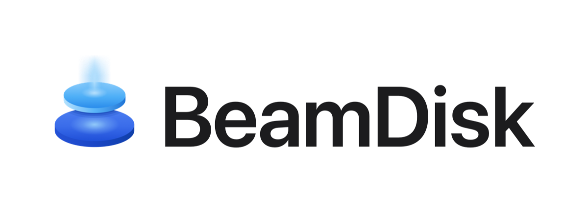
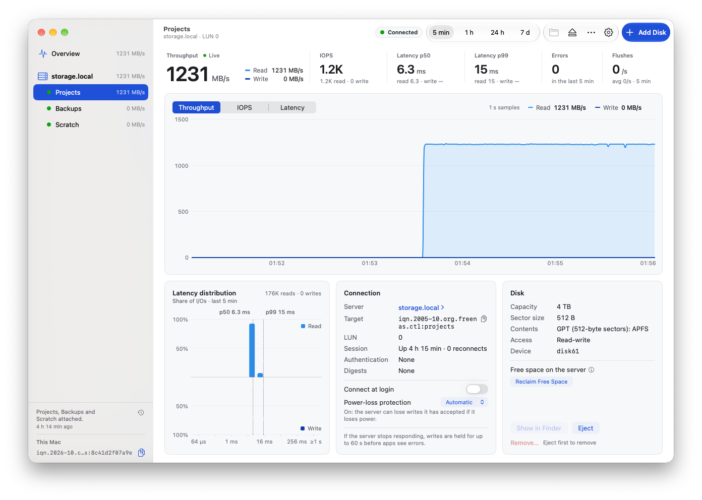
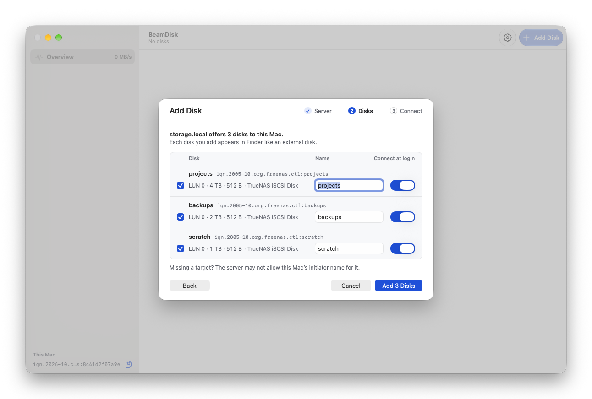
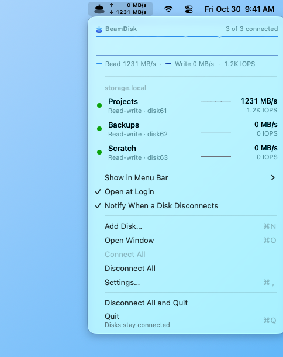

  <a href="https://beamdisk.app">
    <picture>
      <source media="(prefers-color-scheme: dark)" srcset=".github/assets/beamdisk-lockup-dark.png" />
      
    </picture>
  </a>

  <strong>High Performance iSCSI for Macs with Apple Silicon.</strong> 
  Your storage server's disks in Finder and Time Machine. No kernel extension that requires downgrading your Mac's security like legacy solutions.

  <a href="https://beamdisk.app">Website</a> ·
  <a href="https://beamdisk.app/docs/">Documentation</a> ·
  <a href="https://beamdisk.app/download/">Download</a> ·
  <a href="https://github.com/3rdBitLabs/BeamDisk/discussions">Discussions</a> ·
  <a href="https://github.com/3rdBitLabs/BeamDisk/issues">Issues</a> ·
  <a href="https://beamdisk.app/contact/?category=support">Private support</a>

  
  
  
  

---

## What is BeamDisk?

BeamDisk connects a Mac with Apple Silicon to iSCSI storage on a server, a NAS, or SAN. The disk shows up in Finder, Disk Utility and Time Machine like a drive plugged into the Mac, easily saturating a 10 Gigabit Ethernet connection, and needs no kernel extension or change to the Mac's security settings. It's free to download and free for home use; business use needs a license.

  <picture>
    <source media="(prefers-color-scheme: dark)" srcset=".github/assets/screenshot-transfer-dark.png" />
    
  </picture>
   
  Projects reading at 1,231 MB/s on 10 GbE: the recorded sequential-read run from the <a href="https://beamdisk.app/benchmarks/">benchmarks</a>, replayed in the app.

## Highlights

- **No kernel extension** - installs from the App Store like any app. Turn it on once in System Settings: no Recovery-mode restarts, no Reduced Security.
- **Line-rate on 10 GbE** - over 99% of what the link can carry, reading and writing. [The benchmarks](https://beamdisk.app/benchmarks/) show every run and what it ran on.
- **Finds your disks** - enter your server's address and BeamDisk lists every disk it offers this Mac. Tick the ones you want and name them.
- **Time Machine to your server** - use an iSCSI disk as a Time Machine destination for better performance and resiliency than SMB.
- **Rides out outages** - if the server stops answering, writes are held for up to 60 seconds and BeamDisk reconnects by itself.
- **One Mac at a time, enforced** - exclusive access stops a second computer from writing to the disk and corrupting it.
- **Live in the menu bar** - throughput and IOPS at a glance, with graphs and p50 / p99 latency kept for 7 days.
- **Test Speed, built in** - eight tests in about a minute show what your own server and network can do.

<table>
  <tr>
    <td width="62%" valign="top">
      <picture>
        <source media="(prefers-color-scheme: dark)" srcset=".github/assets/screenshot-add-disk-dark.png" />
        
      </picture>
      
Add Disk lists what your server offers this Mac.

    </td>
    <td width="38%" valign="top">
      <picture>
        <source media="(prefers-color-scheme: dark)" srcset=".github/assets/screenshot-menu-bar-dark.png" />
        
      </picture>
      
Live throughput in the menu bar, and every disk one click away.

    </td>
  </tr>
</table>

## Requirements

- A Mac with Apple Silicon (M1 or later)
- macOS 27 or later
- An iSCSI target on a storage server or SAN. Tested with TrueNAS and Linux LIO / targetcli.
- Wired Ethernet recommended

The [compatibility page](https://beamdisk.app/docs/reference/compatibility/) has the details.

## Get BeamDisk

BeamDisk is in public beta. [**Join the beta on TestFlight**](https://testflight.apple.com/join/jKcTwQ9D), or see [Download](https://beamdisk.app/download/). Then follow [Install BeamDisk](https://beamdisk.app/docs/getting-started/install/) and [Add your first disk](https://beamdisk.app/docs/getting-started/add-a-disk/).

---

## About this repository

This is the **community repository** for BeamDisk. It holds no source code: it's where you report bugs, ask questions, share results and follow announcements.

### Where to do what

| Need | Go here |
|---|---|
| Report a bug | [Open an issue](https://github.com/3rdBitLabs/BeamDisk/issues/new/choose) |
| Request a feature | [Open a feature request](https://github.com/3rdBitLabs/BeamDisk/issues/new/choose) |
| Ask for help, share tips, chat | [Discussions](https://github.com/3rdBitLabs/BeamDisk/discussions) - *Support* and *General* categories |
| Get help privately (your server's details, logs you'd rather not post) | [Contact form](https://beamdisk.app/contact/?category=support) - *Support request* |
| Share your Test Speed results | [Discussions](https://github.com/3rdBitLabs/BeamDisk/discussions) - *Benchmarks* category |
| Licensing, volume purchase, a pilot | [Contact form](https://beamdisk.app/contact/?category=business) - *Business and licensing* |
| Qualify BeamDisk with your storage | [Contact form](https://beamdisk.app/contact/?category=vendor) - *Storage vendor qualification* |
| Report a security vulnerability | [Privately, as SECURITY.md describes](SECURITY.md) |
| Read the docs | [beamdisk.app/docs](https://beamdisk.app/docs/) |
| Press, media, or review coverage | [Press kit](press-kit/) |

Public or private? Discussions help the next person with the same problem, so ask there when you can. Use the contact form when your question needs details you don't want on the internet.

### Filing a useful bug report

A few things help us reproduce quickly:

- Your BeamDisk version - BeamDisk → **About BeamDisk**, with the window in front
- Your Mac's model and macOS version - e.g. *Mac mini M4, macOS 27.0.1*
- Your storage server or SAN and its software version, and how it's connected - e.g. *TrueNAS 25.10, 10 GbE, wired*
- The disk's state in BeamDisk and since when, and the **Last event** on its page, with its time
- BeamDisk's **Recent messages** - click the clock button at the bottom of the window's sidebar
- What you did, what you expected, and what happened

**Never post your CHAP secrets.** In public posts you may want to replace your server's address and target names with placeholders.

### Sharing your Test Speed results

If you've measured BeamDisk on your own setup, post the results in the [Benchmarks discussion category](https://github.com/3rdBitLabs/BeamDisk/discussions). Helpful details:

- Mac model, chip and memory
- Storage server or SAN, its software version, and the pool or disks behind the LUN
- Network: link speed, MTU, and what's between the Mac and the server
- A screenshot of [Test Speed](https://beamdisk.app/docs/performance/test-speed/)'s results

The more apples-to-apples your setup, the more useful your post is for the next person sizing their storage.

---

  <a href="https://beamdisk.app">beamdisk.app</a> ·
  <a href="https://beamdisk.app/docs/">Docs</a> ·
  <a href="https://beamdisk.app/download/">Download</a> ·
  <a href="https://github.com/3rdBitLabs/BeamDisk/discussions">Discussions</a> ·
  <a href="https://github.com/3rdBitLabs/BeamDisk/issues">Issues</a> ·
  <a href="https://beamdisk.app/contact/?category=support">Private support</a>

