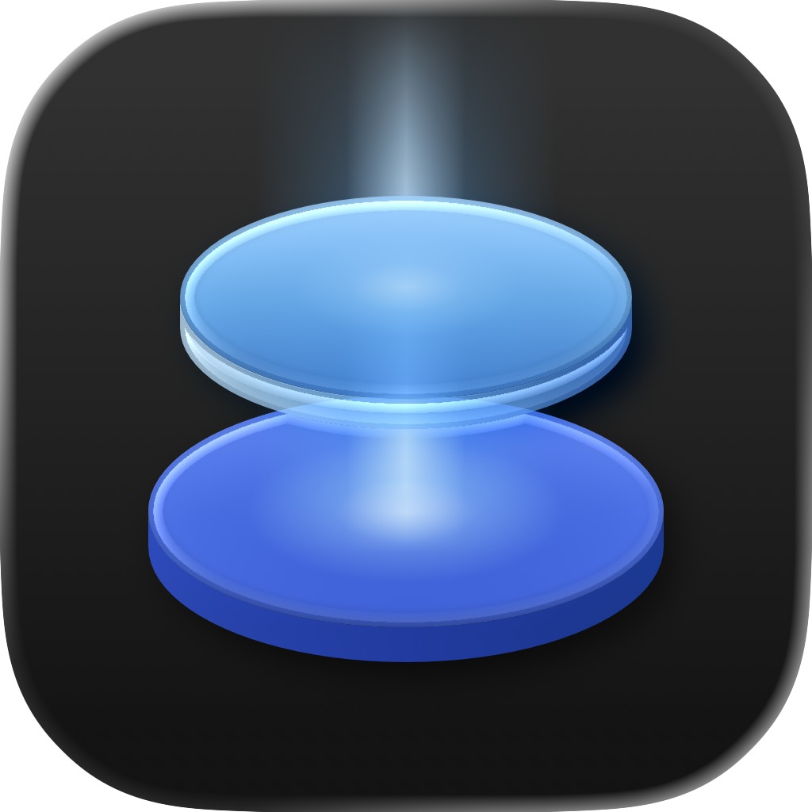

# BeamDisk Press Kit

Assets and reference material for journalists, bloggers and reviewers covering BeamDisk.

If you need other assets, a review build, or want to coordinate on an embargo, [get in touch](https://beamdisk.app/contact/?category=press).

---

## Boilerplate

> BeamDisk connects a Mac with Apple Silicon to iSCSI storage on a server or SAN. The disk shows up in Finder, Disk Utility and Time Machine like a drive plugged into the Mac, reads at over 1 GB/s on 10 GbE, and needs no kernel extension or change to the Mac's security settings. It's free to download and free for home use; business use needs a license.

## One-liners

- **Tagline:** Beam your LUNs to your Mac.
- **Short description:** Fast iSCSI for Macs with Apple Silicon.
- **Long description:** An iSCSI initiator for Macs with Apple Silicon. Connect to your storage server or SAN, and its disks appear in Finder and Time Machine like local drives, at over 1 GB/s on 10 GbE. No kernel extension, no Recovery-mode restarts, no lowered security.

## Quick facts

| | |
|---|---|
| **Name** | BeamDisk |
| **What it is** | iSCSI initiator for macOS |
| **Made by** | [3rd Bit Labs](https://3rdbitlabs.com) |
| **Platform** | macOS 27 or later |
| **Architecture** | Apple Silicon (M1 or later) |
| **Distribution** | Mac App Store; public beta on TestFlight |
| **Install** | No kernel extension, no restart, no change to the Mac's security settings |
| **Targets** | Standard iSCSI. Tested: TrueNAS, Linux LIO / targetcli |
| **Speed** | 1,230 MB/s read and 1,236 MB/s write on 10 GbE, each over 99% of the link ([benchmarks](https://beamdisk.app/benchmarks/)) |
| **Time Machine** | Supported, after a one-time setup |
| **Pricing** | Free to download and free for home use; business use needs a license ([pricing](https://beamdisk.app/pricing/)) |
| **Privacy** | No account, no analytics |
| **Website** | https://beamdisk.app |
| **Documentation** | https://beamdisk.app/docs/ |
| **Community** | https://github.com/3rdBitLabs/BeamDisk/discussions |

---

## Logo

| File | Size | Use |
|---|---|---|
| [`beamdisk-icon-1024.png`](beamdisk-icon-1024.png) | 1024 × 1024, PNG with alpha | The app icon. Scale down as needed. |
| [`beamdisk-lockup-dark-text.png`](beamdisk-lockup-dark-text.png) | 2764 × 1029, PNG with alpha | Logo and name, for light backgrounds. |
| [`beamdisk-lockup-white-text.png`](beamdisk-lockup-white-text.png) | 2764 × 1029, PNG with alpha | Logo and name, for dark backgrounds. |
| [`beamdisk-mark.svg`](beamdisk-mark.svg) | Vector | The logo mark on its own. |
| [`beamdisk-og-1200x630.png`](beamdisk-og-1200x630.png) | 1200 × 630, PNG | Social card; suitable for an article hero or thumbnail. |

### Logo dos and don'ts

**Do:**
- Use the logo in its colors. It's designed to read on light and dark backgrounds.
- Preserve clear space around the logo. Don't crop in tight.
- Use the lockup with dark text on light backgrounds, and the one with white text on dark backgrounds.

**Don't:**
- Recolor, distort, rotate, or add effects (glow, drop shadow, outline, gradient overlay).
- Rebuild the lockup with another typeface, or move the mark relative to the name.
- Combine the logo with other logos in a way that implies a partnership we haven't announced.
- Use the logo as the mark for your own product, dashboard or service.

---

## Screenshots

| File | Shows |
|---|---|
| [`screenshot-disk-light.png`](screenshot-disk-light.png) · [`dark`](screenshot-disk-dark.png) | A disk's page, reading at 1,231 MB/s on 10 GbE (the recorded sequential-read run from the benchmarks, replayed) |

More screenshots of the app, in light and dark, are in [`.github/assets`](../.github/assets/).

## Brand colors

BeamDisk's logo is two discs in two blues, with a beam of light falling on the top one. The app follows the Mac's appearance, light or dark.

| Role | Hex | Notes |
|---|---|---|
| Sky | `#4FB0F7` | The top disc and the beam. Reads in the app's charts. |
| Royal | `#1F50D8` | The lower disc. The app's accent; writes in its charts. |
| Deep | `#0F3FA8` | Edges and shadow. |

## Typography

BeamDisk uses the **system font** everywhere: SF Pro on Apple platforms. The name in the lockup is SF Pro Semibold. There is no custom BeamDisk typeface.

---

## Voice and messaging

A few notes on how we talk about BeamDisk, in case you want to mirror the framing:

- **"No kernel extension"** is the point. Installing BeamDisk takes no Recovery-mode restart and no lowered security. It's an app, from the App Store.
- **"Storage server" or "SAN"**: BeamDisk works with any standard iSCSI target, from a server in a homelab to a SAN in a rack.
- **"Apple Silicon"**: BeamDisk is for M-series Macs. Intel Macs aren't supported in version 1.
- **Speeds come from recorded runs.** Every number we publish is on the [benchmarks page](https://beamdisk.app/benchmarks/) with what it ran on. Your results depend on your server, its disks and your network; BeamDisk's Test Speed measures them.

---

## Contact

- **Press:** [contact form](https://beamdisk.app/contact/?category=press) - *Press*
- **Security issues:** see [SECURITY.md](../SECURITY.md)
- **General community:** [GitHub Discussions](https://github.com/3rdBitLabs/BeamDisk/discussions)

## License for press use

The assets in this directory may be used in editorial coverage of BeamDisk: news articles, blog posts, reviews, videos, podcast cover art, conference slides. You may resize and crop as needed for layout.

You may **not** use these assets to:

- Imply endorsement, partnership, or affiliation that hasn't been announced.
- Brand your own product, service, app, or dashboard.
- Register domain names containing "BeamDisk".
- Sell merchandise featuring the BeamDisk name or logo.
